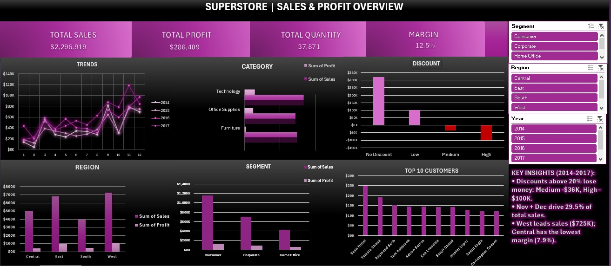
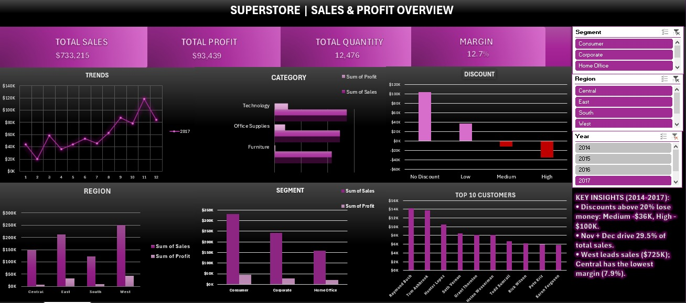

# Superstore Sales Analysis | Excel

Business analysis of 9,993 order lines (2014-2017) to understand what
drives sales and profit, built for the **UneeQ Interns** Data Analysis
program.

## Dashboard

## Problem
Management needs to know how the business is performing and where it
is losing profit.

## Dataset
[Superstore Sales (Kaggle)](https://www.kaggle.com/datasets/vivek468/superstore-dataset-final)
- 9,994 rows originally, 21 columns, US orders, 2014-2017.

## What I did
1. **Cleaning:** checked blanks, dates, duplicates (removed 1 duplicate
   line, leaving 9,993 rows), text spacing, and postal codes. Full log
   is in the `Cleaning Log` sheet.
2. **Helper columns:** Year, Month, Profit Margin, Delivery Days,
   Discount Band, Result, Region Target (lookup).
3. **Pivot tables** for trend, category, region, segment, discount, and
   top customers.
4. **Dashboard** with KPI cards, 6 charts, and Year / Region / Segment
   slicers.

## Key results
- Sales **$2.30M**, profit **$286K**, margin **12.5%**.
- Sales grew **51%** from $484K (2014) to $733K (2017).
- Nov + Dec generate **29.5%** of sales.
- Discounts above 20% lose money: Medium **-$36K**, High **-$100K**.
- Furniture earns only **2.5%** margin; Tables lose $17.7K.
- West leads sales ($725K); Central has the lowest margin (**7.9%**).

## Recommendations
1. Cap discounts at 20% and require approval above it.
2. Review Table pricing and Furniture discounting.
3. Plan inventory and campaigns for Q4.
4. Investigate Central region discounting.

## Files
| File | Description |
|---|---|
| `Superstore_Analysis.xlsx` | Cleaned data, pivots, dashboard |
| `Insight_Memo.md` | One-page business memo |
| `dashboard.jpeg`, `dashboard_2017.jpeg` | Dashboard screenshots |

## Assumptions and limitations
- Region targets and managers are illustrative (not in the source data).
- No cost or returns data; correlation is not causation.

## Video walkthrough
[Watch here]((https://youtu.be/gAULTAPrXeo))

## Author
Shahd Aboetab | [LinkedIn](https://linkedin.com/in/shahdaboetab)
